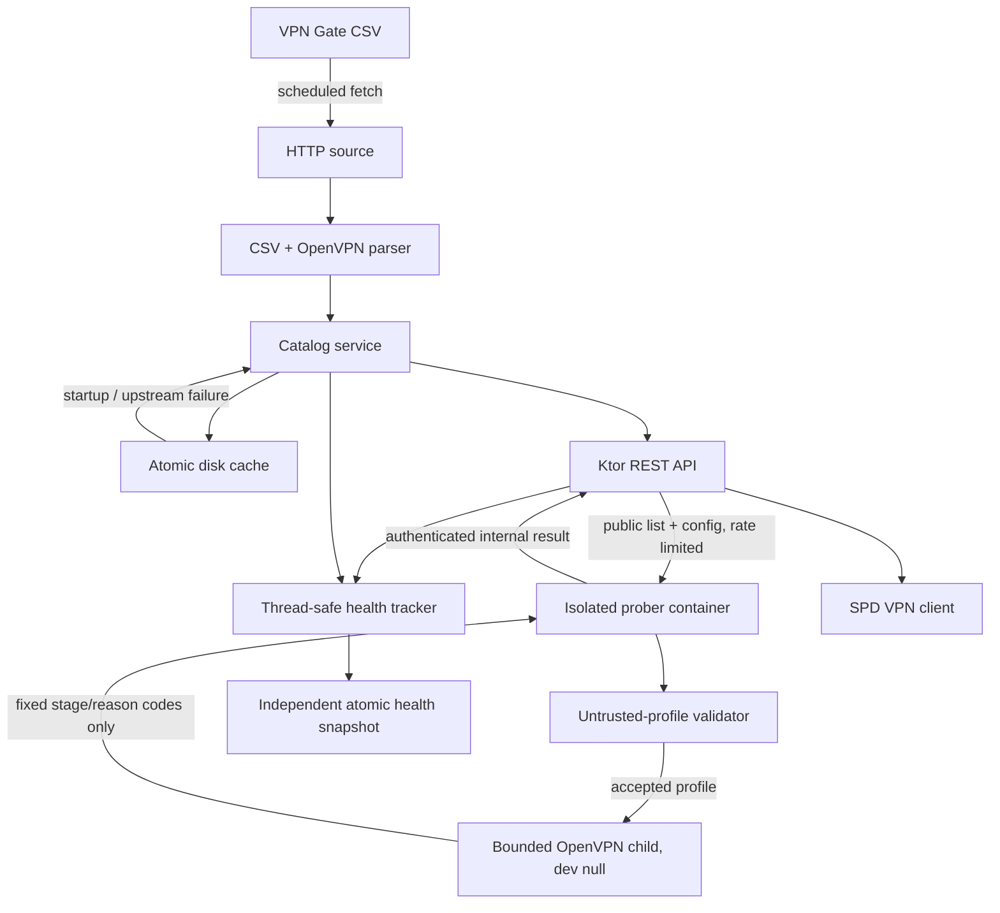

# Architecture

## Failure rules

1. Startup loads the last-known-good snapshot if it exists.
2. The scheduler then fetches VPN Gate immediately.
3. A response must contain the expected header and at least one valid embedded OpenVPN profile.
4. Only validated snapshots replace the in-memory catalog.
5. Disk writes use a sibling temporary file followed by an atomic move where the filesystem supports it.
6. If refresh fails, the existing catalog remains available and health becomes `degraded`.
7. If neither disk cache nor upstream can provide data, catalog routes return `503 CATALOG_UNAVAILABLE`.
8. Corrupt or missing health persistence is ignored at startup; catalog availability is unaffected.
9. Health records contain only server ids and probe outcomes. Catalog identity and OpenVPN configuration always come from the current catalog snapshot.
10. Health entries are marked absent during catalog reconciliation and pruned after 24 hours of continuous absence.
11. API `429`/`5xx`, malformed responses, config-download errors, child-process startup errors, report errors, and cancellation are infrastructure failures and never alter server health.
12. A probe success is emitted only after OpenVPN prints its initialization-complete signal. The child is then terminated, reaped, and its per-probe directory is removed.

## Phase-two trust boundaries

- The API process never executes OpenVPN and its image does not contain OpenVPN.
- The prober is a separate JVM application and Docker image. It reaches the API by Compose DNS at `http://api:8080`; the public Caddy example blocks `/internal`.
- Profiles are untrusted. Script/plugin/management/process-control directives and external key/certificate paths are rejected before a file is written.
- Accepted profiles are followed by worker-owned command-line overrides: client mode, null device, no interface configuration, no routes, no pulled routes, script security level zero, no credential cache, one connect attempt, bounded DNS/poll timeout, and controlled verbosity.
- `ProcessBuilder` receives an argument list directly. No shell evaluates the profile, server id, path, or credentials.
- Every probe gets an owner-only directory and `0600` profile/auth files. The worker supplies only `vpn`/`vpn`, captures output in memory only for fixed-code classification, and deletes the directory after every outcome.
- The container is non-root, drops all capabilities, has `no-new-privileges`, a read-only root, bounded tmpfs, CPU/memory/PID limits, and no TUN, devices, ports, host network, volume, or Docker socket.

## Intentional boundaries

- No user or device identity.
- No premium VPN infrastructure.
- No database or admin panel.
- No active probing inside the API process.
- No traffic tunneling or TUN interface. Phase 2 checks only the control-plane connection milestone.
- No retry queue or durable worker state; the API health snapshot remains the source of health history.
- No fabricated protocol conversions.
- No ad, analytics, or payment integration.
